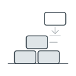

# How the team builds a part of the wiki

An agent writes most of this wiki, but what made our parts of it work was what we did as people around it: knowing what a part was for before asking for anything, and keeping the direction, the judgment and the last word ourselves.

This is written for someone starting from scratch, where we started, with a part to build and an agent to build it with. It is our way, drawn from our own notes, not set in stone or ratified, and it may change. Why people are needed at all is argued in [the team's reflections](reflections.md).

*The team's reading of its own work, September and October 2026. Not yet tried on a part built after it was written, so the whole is open.*

## 1. What you are building

A part of this wiki is a holon. The smallest piece of one is a [brief](the-rule/rule.md#32--the-brief): a heading and its prose, giving one understanding.

A [holon](the-rule/rule.md#321--the-holarchy) is a brief with everything beneath it. It can be read on its own as a whole, it belongs to the understanding above it, and what it did not need is broken down beneath it. Every brief is the top of a holon, from a single section to the whole wiki.

Pages join into one body through [a link standing alone in its own paragraph](the-rule/poc/practice.md#3-a-lone-link-places-a-part), which places the linked page there as a part and shows as a card. A link inside a sentence places nothing; it is only an offer to the reader. [The portal guide](portal/README.md) is a finished holon worth opening to see one.

*From the rule and its practice, as we understood them; the example is ours.*

## 2. What helped us

These are the things that helped us most while building. They roughly follow a session from its start to its end, but they are not steps, and each can be read alone.

*Seen in our own work; how much each helps is not measured.*

### 2.a Knowing the why before you prompt

Before asking the agent for anything, we needed to know what the holon was for and who would read it: a developer, a mechanic, someone at Save the Children. That is a judgment about purpose, and it was ours to make.

When we did not know, the agent could not know either. Telling it to read the rule again and do as it says only brought back the decisions it had left for us, and we went in circles. What broke the circle was a person deciding.

*Seen in our work.*

### 2.b Choosing the sources

What a part was drawn from was ours to choose, and so was whether a source could be used yet. A recorded meeting, for instance, is used only once everyone in it has [approved its transcript](transcripts/README.md#2-approval). Choosing the sources is also choosing what the holon will not say.

*Seen in our work.*

### 2.c Keeping a session to one task

We learned to ask the agent what it had read at the start of a session, rather than assume it had read only what we named. It reads some files by itself when a session opens, and sometimes others without saying so.

A session went best with one task in it. Side questions seemed to crowd it and weaken the main work, so we took them to a session of their own.

*Seen in our work.*

### 2.d Talking before writing, in small steps

In a first session, we asked the agent what was there and talked it through before deciding what to build. After that we usually agreed on [an outline](the-rule/rule.md#52--the-step) before any prose, and then on a sample of one small piece, adjusted until it read right, before the whole was written.

The point was never to let it write faster than we could read. A person can only steer what they have read, and a fault caught in the outline costs nothing to fix.

*Seen in our work.*

### 2.e Staying the one who steers

We kept the direction ourselves and checked the agent's work rather than trusting it, for reasons [the reflections](reflections.md#1-the-agent-keeps-the-instructions-people-keep-the-purpose) give.

Above all, we closed the gaps between the text and the real world, which the agent cannot see. We explained context it never had and corrected claims that turned out wrong. Where people work around something in real life, we put the workaround into words. Left open, each gap is a hole the agent falls through.

*Seen in our work.*

### 2.f Reading it as its reader

We used [fresh heads](the-rule/rule.md#54--the-fresh-head) to find what a draft failed to give, but judging how it would land for the real reader stayed with us, since only we knew who that reader was.

We were tempted to judge a brief by its length, and counting words did not help. What helped was reading the whole again after each rewrite, until the rewrites changed only words.

*Seen in our work.*

## 3. Deciding, and marking it honestly

At the end of a piece of work, a few decisions fell to us, since only people could make them. We marked how sure each claim was, which can be done honestly only by someone who has read what it marks, and decided what stayed open. Agreeing to a file as a whole, which the rule's practice calls [ratifying it](the-rule/poc/practice.md#24-a-ratified-file-is-edited-only-in-review), we did only once we had read it whole.

What was decided, and what was left open, goes into [the log](log/README.md), so the next person starts from there rather than from memory.

*Seen in our work; recording in the log is in force, from the log's own page.*

## 4. Open questions

Some questions about working this way are not answered.

- Who has to agree on an outline or a draft: one person trusted to decide for a holon, or the whole team reading it each time.

- Whether this page holds. It was written before being used, so it is meant to be tried on the next holon, revised from what that shows, and only then can it be treated as our way.

*Open, both of them.*
