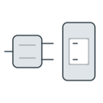

# The API

The API, in `api/`, is a Spring Boot application in Java 21, with PostgreSQL. It is laid out with one package per kind of thing it keeps, each built the same way, and it keeps almost everything behind a login.

The [API's readme](../../api/README.md) gives its patterns in detail, with the reasons behind them and the rules each service follows. It is not yet brought into the wiki.

*Seen, in `api/`, read 2026-10-20.*

## 1. One package per kind of thing

The packages stand in `api/src/main/java/se/hjulverkstan/main/feature/`, and each has the same three parts.

The controller reads the request and hands it on. The service does the work in one transaction: it checks the data, loads what it needs, applies the change and saves it. The repository reads and writes the database.

Each kind of thing has one main data transfer object, a DTO, which is both what a request sends and what an answer returns.

*Seen, in `api/pom.xml` and the feature packages.*

## 2. Its requests

A request's path starts with `/v1/api/` and names the kind of thing asked about: `auth` for logging in, then `vehicle`, `ticket`, `customer`, `employee`, `location`, `user`, `image`, `web-edit`, and `site` for the vehicles the public site shows live.

A browser never writes the `/v1`. It asks for `/api/…`, and what stands in front of the API adds it: in an environment, the address; on a developer's machine, the small server the website runs on while it is worked on.

The API lists every request it answers, with what each takes and gives, at `http://localhost:8080/api/swagger-ui.html`, and that list is the place to look a request up. It sits outside `/v1`, so an environment's address, which adds the `/v1`, likely does not reach it; it is read on a developer's machine.

*Seen, in the controllers, `application.properties`, `cdk/lib/app.ts` and `web/scripts/dev.js`. That the list is out of reach through an address is reasoned from its path, not tried.*

## 3. The tables

No tool manages the database's tables, and the API never changes them unless told to. Two settings, `SPRING_JPA_HIBERNATE_DDL_AUTO` and `SPRING_SQL_INIT_MODE`, make it create them and load the first data. They are set by hand for one start, and removed again.

Any later change to the tables is made by hand in each environment, as [what a delivery does not change](pipeline/delivering/README.md#3-what-a-delivery-does-not-change) explains.

*Seen, in `api/pom.xml`, `application.properties`, `docker-compose.yml`, `SETUP.md` and the infrastructure readme.*

## 4. Who may ask what

Almost everything the API holds is behind a login. Staff log in through the portal, and the API answers with two cookies that the browser keeps and sends back with every request: an access token that lasts fifteen minutes, and a refresh token, lasting seven days, that renews it. The page's own code cannot read either.

A few requests are open to anyone: logging in, renewing a login and logging out, the vehicles the public site shows, the API's own description, and a health check.

*Seen, in `WebSecurityConfig.java`, `CookieUtils.java` and `application.properties`.*

### 4.1 Users, employees and roles

A user is an account to log in with, and an employee is a person who works in a workshop. The workshops' computers are shared, so several people work under one login, and a ticket names the employee rather than the user.

A user is an admin or an ordinary user. A third role is kept for the build that pre-renders the public site, so it can log in and fetch web edit's content; its login is kept on GitHub with each environment's secrets.

*Seen, in `ERole.java` and the workflows; why users and employees differ is from the project's readme.*

## 5. What it does on its own

Two things happen beyond answering requests. When staff mark a repair completed and confirm it in the portal, the API sends the customer a text message, through Amazon's messaging service. And twice a week, at three in the morning on Tuesday and Saturday, it removes images from the store that nothing points to any more.

*Seen, in `TicketService.java`, `ShopTicketsActions.tsx`, `S3OrphanFileCleanup.java` and `application.properties`.*
