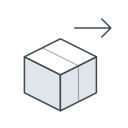
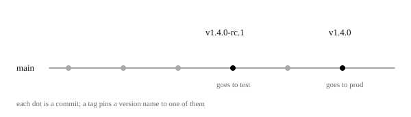

# Delivering a change

Every delivery runs the same four steps in the same order, whatever starts it, so a change that fails its check is never built for delivery and never deployed. What starts it, a merge, a release's tag or a button, decides only where it goes and how much of it goes. What lies beneath the software, its tables, servers and settings, stays with people.

The steps are one workflow, `pipeline.yml`, which the Actions tab lists as *Deploy*.

*Seen, in `pipeline.yml`, read 2026-10-05; not checked against a real run.*

## 1. What a run does

The four steps are decide, check, build and deploy. Within each part, each step waits for the one before it; between the API and the website, §1.4 says what waits for what.

\
A pull request only runs the check. Every delivery runs the same four steps, and what starts it decides where it goes and how much of it goes.

*Seen, in `pipeline.yml`.*

### 1.1 Where it goes

What starts the run decides the environment.

- A merge into `main` goes to dev. So dev runs the newest `main`, unless someone has since delivered a branch there by hand, as §4 shows.

- A release candidate's tag goes to test, and a final release's tag goes to prod. [§2](#2-releases-are-tags) gives the forms a tag must have.

- The *Run workflow* button goes where [§4](#4-delivering-by-hand) says.

*Seen, in `pipeline.yml`.*

### 1.2 What it delivers

A merge delivers only the parts it changed, and a release delivers both.

- A merge delivers what it changed in `api/`, in `web/`, or both, and leaves the other part as it is. If it changed neither, the run stops, since there is nothing new to deliver. That includes a merge that changes only the pipeline's own files.

- A release always delivers both, since a release is the whole system at one version.

What it decided stands in the run's summary: the environment, and whether it delivers the API, the website or both.

It also counts a change in a folder `.github/actions/` for both parts, though no such folder exists.

*Seen, in `pipeline.yml`; what a merge counts as changed is from `dorny/paths-filter`'s documentation. The folder is a leftover; open.*

### 1.3 It checks what it delivers

The check is the one a pull request runs, [checking every change](../checking.md), with only the parts for what is being delivered. A delivery of the website alone skips the API's tests, but still builds and starts the API for the website's part.

*Seen, in `pipeline.yml` and `stage-test.yml`.*

### 1.4 It builds and deploys each part its own way

The API and the website are built and deployed separately, and how their steps are ordered has three effects.

- When a run delivers both, the website goes live only after the API is deployed, so the new site does not reach visitors before the API it talks to. If the API's build or deploy fails, the website is not deployed.

- The API's deploy does not wait for the website's build. So if the build fails, the new API still goes live, beside the old website.

- The website's build runs while the API is built and deployed, and nothing orders the two. So the build may read its text and images from the old API or from the new one; and if it reads while the API is restarting, it fails. Reading from the old API is harmless while the parts of the API the build reads stay the same.

\
One delivery of both parts. The website waits for the API's deploy, but the API never waits for the website's build, and that build runs while the API restarts.

Each part's own way is a page of its own, for when you need to know how your part reaches its server or its visitors.

[The API's path](api.md)

[The website's path](web.md)

*Seen, in `pipeline.yml` and `stage-deploy-api.yml`. Why the website waits is reasoned, since the file does not say. What the build reads, and its failing during a restart, are open, and not seen in a run.*

### 1.5 Runs do not wait for each other

Nothing stops two runs from working on one environment at once: a merge, a run by hand and a republish can overlap, and the last to finish wins.

*Seen, in `pipeline.yml` and `publish.yml`, which set no limit; what overlapping runs do is reasoned.*

### 1.6 Each run uses its own commit's pipeline

A run uses the workflow files as they are in the commit it runs on. So a delivery to test or prod picks up a fix to the pipeline only with the next release. A republish is the exception: it runs the files of the branch it is started from, `main` as [republishing](../republishing.md#1-how-to-republish) says, so a fix to the website's build or deploy reaches it as soon as it is merged.

*GitHub's documented behaviour, not checked here.*

## 2. Releases are tags

The pipeline holds a release's tag to two rules, so that what is released is always one known, merged version.

- It is written `vX.Y.Z` for a final release, such as `v1.4.0`, or `vX.Y.Z-rc.N` for a release candidate, such as `v1.4.0-rc.1`, so people and the pipeline can read what kind of version it is.

- Its commit is on `main`, so everything released has been merged.

\
Two tags on `main`. The release candidate goes to test. The final release, on a later commit, goes to prod.

A tag that starts with `v` but breaks a rule fails the run, and the log says which rule. A tag that does not start with `v` starts nothing at all, and shows no error. Either way, delete it with `git tag -d <tag>` and `git push --delete origin <tag>`, then tag the right commit.

How to make a release, with its release notes, is in the [release process](../../../../GUIDELINES.md#release-process-). It is partly out of date: it names a workflow `release.yml`, which is now `pipeline.yml`, gives the API's image tags as names no longer in use, and some of its examples have no `v`.

*Seen, in `pipeline.yml` and `GUIDELINES.md`; the out-of-date process is open.*

## 3. What a delivery does not change

A delivery changes the API and the website, and leaves what lies beneath them to people, in each environment.

- **The database's tables.** No delivery changes them: the API is set never to, and there is no tool for it. So a change to how the data is stored is made in each environment's database by hand, before the API that needs it is delivered. Until that API arrives, the old one runs against the changed tables, so the change is best made in a way the old API still fits.

- **The servers.** The servers, and what runs on them, are set up by people running CDK, not by the pipeline, as the [infrastructure readme](../../../../cdk/README.md) shows. [The API's server](api.md#3-the-server) says what that leaves on each one.

- **The settings.** Each environment's addresses, names and passwords are kept on GitHub as its [variables and secrets](../basics/reading.md#5-environments-variables-and-secrets), never in the files. They are set there by hand, and building and deploying only read them. One secret is the exception: the key the API signs its logins with is written in `application.properties`, so it is the same in every environment and readable by anyone who can read the code.

One thing beneath moves anyway: a deploy of the API can move the database to a newer version of Postgres 17, as [what a deploy does](api.md#4-what-a-deploy-does) says.

*Seen, in `application.properties`, `api/pom.xml`, the workflow files and `cdk/README.md`. That the tables are changed before the API is delivered, and the window it leaves, are reasoned. The written-in key is open.*

## 4. Delivering by hand

Sometimes a delivery must run without a new change: after a failure, to try something, or to go back. The *Run workflow* button on *Deploy* in the [Actions tab](../basics/README.md#5-pipelines-on-github) runs it on the branch or the tag you choose.

- On a branch, it delivers to dev, and you choose the parts: the API, the website, both, or what the branch has changed since it left `main`. On `main` itself that last choice sees only the newest commit, so choose both.

- On a release's tag, it delivers that release again to the environment its tag names, both parts. The release candidates' tags up to `v1.0.0-rc.3` were made before the pipeline took its present form, and their workflow files use other settings' names, so running the workflow on them does not do what this page describes.

A branch other than `main` leaves its code on dev until a later run replaces it, and a later merge replaces only the part it changes. So tell the team before you deliver a branch.

*Seen, in `pipeline.yml`; "choose both" is also the [infrastructure readme's](../../../../cdk/README.md#7-trigger-pipeline) advice. What a branch has changed is from `dorny/paths-filter`'s documentation, and what `main` alone sees from its code; what stays on dev is reasoned; neither tried. The old tags, seen with git, 2026-10-07.*

### 4.1 Going back

An earlier version can be put back on prod in two ways.

- Run the workflow on the earlier release's tag, as above.

- Tag the earlier commit with a new version. The pipeline delivers whatever commit a tag names, and nothing compares the new version with the old.

Neither takes the database back, so the old API meets the tables as they are now. The website is rebuilt with today's text and images, and the old workflow files run with today's settings.

On 2026-10-05, `v1.0.0` is the only final release's tag, so prod has never run an earlier final release, and only the second way can go back from it.

*The tags seen, 2026-10-05; the rest reasoned from `pipeline.yml` and §1.6, not tried.*

## 5. When a delivery fails

A failed step stops what comes after it in its part, and its log says why; the other part may still go live, as §1.4 says. The common causes can be read from the files.

- **The check fails.** Read it as [a red check](../checking.md#4-when-the-check-is-red).

- **A tag is refused.** It breaks a rule in [§2](#2-releases-are-tags), which also says how to replace it.

- **The API's image is not built, or the server cannot be reached.** The website is then not deployed either, as §1.4 says. The log of the failed step names what failed.

- **The API does not become healthy.** [What a deploy does](api.md#4-what-a-deploy-does) says what it waits for and what it prints.

- **The website's build fails on its own.** The new API may already be live, as §1.4 says, so fix the website soon.

- **The website's build fails while the API restarts.** It may have read the API at the wrong moment, as [§1.4](#14-it-builds-and-deploys-each-part-its-own-way) says; if so, running it again helps.

- **It is the first delivery to a new environment.** This is expected, as [§6](#6-a-new-environment) explains.

*Seen, in the workflow files, except the failure during a restart, which is reasoned and open; not checked against a failing run.*

## 6. A new environment

The first delivery to a new environment fails, and this is expected. Its database has no tables and no accounts yet, so the website's build cannot sign in to the API.

*Seen, in `application.properties` and `web/src/server.tsx`.*

### 6.1 Filling its database once

The [infrastructure readme](../../../../cdk/README.md#manual-sql-init-on-first-run-of-ec2-instance) says how to fill it once, by hand, with two settings in the server's `.env`: one that makes the tables, `SPRING_JPA_HIBERNATE_DDL_AUTO`, and one that loads `data.sql`, `SPRING_SQL_INIT_MODE`. It gives the first twice, once as `update` and once as `create`, and which is meant is open. The next deploy replaces the server's `.env` whole, so the two settings last only until then.

*Seen, in `cdk/README.md` and `stage-deploy-api.yml`.*

### 6.2 What the fill leaves behind

The fill loads all of the example data in `data.sql`: shops, customers, tickets, and three accounts, `user`, `admin` and `pipeline`, that share one known password and are all administrators. The account named `pipeline` is most likely the one the website's build signs in with, though the build needs only the narrower role `ROLE_PIPELINE`.

On test and prod, replace them before anyone uses the environment, give the build's new account only `ROLE_PIPELINE`, and change its two secrets on GitHub to match. Whether test and prod were filled this way, and still hold those accounts, cannot be seen from the files.

*Seen, in `data.sql` and the API's controllers. Which account the build uses is reasoned, since its secrets are not in the files.*

### 6.3 One setting the readme gets wrong

The infrastructure readme lists `DEPLOY_API_SSH_HOST` as a secret, but the deploy reads it as a variable, so set it as one.

*Seen, in `cdk/README.md` and `stage-deploy-api.yml`.*
