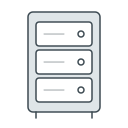

# Where it runs

Each environment is a small set of Amazon services: an address in front, stores for files, and one server for the API and its database. A developer makes them by running the code in `cdk/`.

The [infrastructure readme](../../cdk/README.md) gives every step. It is not yet brought into the wiki.

*Seen, in `cdk/`, read 2026-10-20.*

## 1. The address

The address belongs to CloudFront, Amazon's network for serving the web, which passes each request on by its path, as [the sketch](README.md) shows. The website's files and the images are kept in S3, Amazon's file store, each set in a bucket of its own.

On its way to the API, a request's path gains the `/v1` the API's own paths start with, as [its requests](api.md#2-its-requests) explains.

Before the website's files are read, a small function that CloudFront runs looks for the finished page the path asks for, and falls back to the nearest page above it. So every path under `/portal/` gets the portal's one page.

*Seen, in `cdk/lib/app.ts` and `cdk/lambda/routing.ts`.*

## 2. The server

The server is one small virtual machine in Stockholm. On it, three containers run side by side with Docker Compose: PostgreSQL 17, the API, and a backup that each night writes an encrypted copy of the database to a bucket of its own.

A developer reaches the server over SSH, once given an account on it.

*Seen, in `cdk/lib/app.ts` and `cdk/assets-ec2/`; SSH is as the infrastructure readme describes, not tried.*

## 3. Made with CDK

The code in `cdk/` is AWS CDK, in TypeScript, and a developer runs it in two rounds. The setup round makes what the rest stands on: the environment's DNS zone, its certificate and the function in front of the website's files. The deploy round makes the server, the buckets and CloudFront.

Each environment is meant to have an AWS account of its own. The addresses of dev and test are set when CDK is run, and are not written in the code.

*Seen, in `cdk/bin/cdk.ts` and `cdk/lib/`. The accounts are the infrastructure readme's recommendation; neither they nor dev's and test's addresses were checked against AWS.*

## 4. Settings and secrets

The settings the API runs with, the database's password among them, are kept on GitHub for each environment, and [the API's delivery](pipeline/delivering/api.md) writes them to the server.

On the server, the API needs no keys to use the image store or send text messages, since the server's own role in AWS allows both. The keys the pipeline itself uses, to AWS and to the server, are made by hand and then kept on GitHub.

*Seen, in `stage-deploy-api.yml`, `cdk/lib/app.ts` and `AwsConfig.java`; the keys made by hand are as the infrastructure readme describes, not checked against AWS.*
