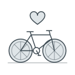

# The initiative

Hjulverkstan is an initiative Save the Children Sweden started in Gothenburg, to support integration and empower the people who live nearby. Its means are bike workshops: the bikes are the medium, and the heart is the community that grows around a workshop and what it does for the people in it.

A workshop is not just a bike shop: it belongs to the people around it.

*Carried from the repository's README and the meeting [with the client](transcripts/2026-08-19-client-meeting.md#4-what-a-hjulverkstan-is--5250-10117), §4; ungraded there and not checked with Save the Children.*

## 1. What a workshop offers

A workshop does two things at once: it serves the people nearby, and it is a workplace for young adults.

For the people nearby it repairs bikes, lends them out and teaches people to cycle, all free. The bikes it lends are its own, restored from bike rooms that landlords clear out.

For the young adults it is a place to learn the work, with a next step meant to follow: becoming an instructor, perhaps a job in a bike shop.

Each workshop becomes what its community needs: in one area a good repair shop, in another a meeting place.

*Carried from the [visit to a workshop](transcripts/2026-09-16-frolunda.md#3-the-workshop-in-frölunda--pt1-4310), §2.2 and §3, and the meeting with the client, §11.3; ungraded there and not checked.*

## 2. Where the workshops are

The workshops stand where they are needed, visible, among the people they serve.

There are five, in areas where many cannot afford to fix a bike, on premises housing companies lend for free. A new centre is planned as neutral ground for all of them, since young people cannot always move between areas, some of which have trouble with each other. Growth is held back on purpose: quality, not quantity.

*Carried from the meeting [with the client](transcripts/2026-08-19-client-meeting.md#5-the-five-places-and-the-partners--3723-5648-10243), §4–6 and §8, as of August 2026; ungraded there and not checked. The new centre is a plan.*

## 3. Where Alten comes in

Running the workshops needs a system that keeps track of bikes, customers, employees and services, and a public website that tells more people about the work. Alten Sweden builds both, as one application, the portal and the website, pro bono, through its interns and its consultants between assignments, and leads the technical development.

The work began early in 2024, and how it went, period by period, is told in [the repository's README](../README.md). By September 2026 the website was live and the portal built, but not yet in use in the workshops; how it is used is in [the portal guide](portal/README.md).

*Carried from the repository's README and the [visit to a workshop](transcripts/2026-09-16-frolunda.md#31-the-place-and-the-people--pt2-0146), §3.1; ungraded there and not checked.*

## 4. Joining

The initiative welcomes contributions from anyone, person or organisation, who shares its vision of stronger, more inclusive communities. The software is open source, and developers, designers and writers can all take part; how, by a pull request, in GitHub Discussions or by getting in touch, is in [the repository's README](../README.md).

Three pages from outside, all in Swedish, say more about Hjulverkstan and are not yet brought in: [Save the Children's own page](https://www.raddabarnen.se/vad-vi-gor/barn-i-sverige/bekampar-utanforskap/plv/hjulverkstan-plv/), and news of a workshop opening from [Poseidon](https://poseidon.goteborg.se/nyheter/nu-oppnar-hjulverkstan-i-backa/) and [Vårt Göteborg](https://vartgoteborg.se/p/hjulverkstan-oppnar-i-backa/).

*Carried from the repository's README, ungraded there. The wording of the page is the session's, 2026-10-14 and 2026-10-15.*
