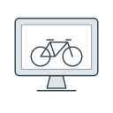

# The portal

The portal is where Hjulverkstan's workshops keep track of every bike and what happens to it. This guide is for the people working in the workshops. It shows, task by task, how to do the everyday work in the portal, from a bike coming in for repair to a loan bike coming back. Anyone else can read it to learn how the portal is used.

*Lean, 2026-10-12: what the guide covers and in what order, from the [Frölunda workshop](../transcripts/2026-09-16-frolunda.md) and the meeting [with the client](../transcripts/2026-08-19-client-meeting.md). Every task was tried on a test copy of the portal, not yet in a workshop.*

## 1. One place instead of notes

Today a workshop keeps its work on paper notes taped to the bikes, in a folder, in a spreadsheet and on private phones. That works, but only the person who wrote a note knows what it says, and a bike can be forgotten in a corner.

The portal keeps all of it in one place, on the workshop's computer. The person who works on a bike updates it there, the young adults too. Then the next person can see what was agreed and what was done.

*Seen: what the workshop does today, in the [Frölunda workshop](../transcripts/2026-09-16-frolunda.md#31-the-place-and-the-people--pt2-0146), §3.1 and §3.2.*

## 2. Three parts, and who uses each

The portal has three parts, and this guide is about the first, the one used every day.

- **Shop** is the everyday work: the bikes, the repairs and the lending. Each workshop is logged in to it on one computer.

- **Admin** is used now and then, to reset a password, add a login or a member of staff, or add a new location. One responsible person is meant to use it, not everyone in the workshop.

- **Web edit** changes the public website: its text, in several languages, and blog posts with their images. About one person is likely to run it.

How Web edit is used is a [page still to come](), once it has been gone through with Save the Children.

*Carried from the meeting [with the client in October](../transcripts/2026-10-15-client-meeting.md#6-the-portal-is-ready--3307), §6 and §10; ungraded there and not checked. Who uses Admin and Web edit is a plan, not yet in practice.*

## 3. Bikes, people and tickets

Shop holds three things, each on its own page. The three icons at the top left open them.

- **Inventory**, the bike icon, holds the bikes: the workshop's own loan bikes, and the bikes customers bring in for repair.

- **Tickets**, the sheet icon, holds the jobs. A ticket is one job: a repair, lending a bike (the portal says *Rent*), or, now and then, giving a bike away (*Donate*) or receiving one (*Receive*). It names the bike, the customer, and the employee in charge of the job.

- **Customers**, the person icon, holds the people who repair or borrow bikes, with their phone numbers.

Repair and lending tickets have a status, which shows where the job is. *Ready* means the job is waiting to be started. It does not mean the bike is ready. *In progress* means someone is working on the bike, or has borrowed it. A repair has one more status, *Completed*, which means the bike is ready for the customer to collect. *Closed* means the job is over. You change a ticket's status in the ⋯ menu at the right end of its row.

\
The Tickets page, with made-up data. Each row is one job.

The workshop's own loan bikes have a status too, which says whether they can be lent:

- **Available**: ready to lend, and shown on the public website.

- **Unavailable**: not to be lent now, for example while it is lent out.

- **Broken**: needs repair before it can be lent.

- **Archived**: no longer in use, for example given away or scrapped.

A customer's bike has no status until its repair is closed, when it is set to *Archived* by itself.

A red mark beside a bike's or ticket's number means something needs attention. Hold the pointer over it to read what, such as "Bike still out past return date" on a lending ticket, or "Bike orphaned: missing ticket" on a bike that has no ticket. Most red marks are a triangle; a paper plane means a text message to the customer failed.

*Seen: tried on a test copy of the portal with made-up data, 2026-10-12. What Broken is for is a guess from its name; the portal sets Archived itself when a repair is closed.*

## 4. The tasks

The tasks follow a workshop's day, with the most common first. Each task has its own page, to read when the task comes up.

Before the first task, one page shows how to log in, how every page of the portal works the same way, and what the phone is for.

[Finding your way at the computer](start.md)

Most of a workshop's work is repairs. A repair starts with the bike coming in, and then the bike waits its turn until it is fixed and collected.

[A bike comes in for repair](repair.md)

[Working through the queue](queue.md)

Lending needs a loan bike in the portal first, set to *Available*. Then a bike is lent and, later, comes back.

[Adding a loan bike](loan-bike.md)

[Lending a bike](lending.md)

[A loan bike coming back](return.md)

Now and then the workshop gives a bike away or receives one.

[Giving away and receiving bikes](give-receive.md)

Last comes a page to look things up in when the portal will not do what you want, or does something you did not expect.

[When the portal says no](no.md)

*Lean, 2026-10-12: the order approved by Emelie the same day, except that adding a loan bike now comes before lending, since lending needs one.*
