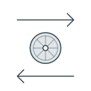
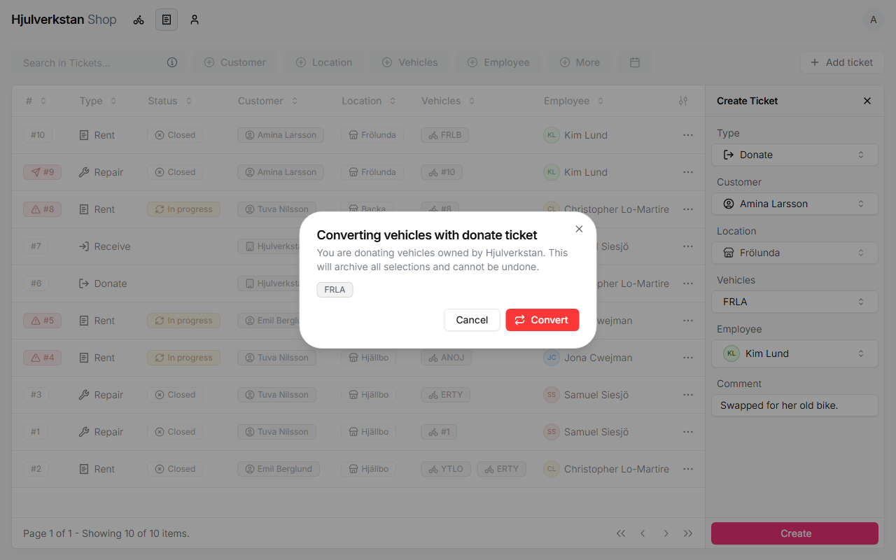

# Giving away and receiving bikes

Now and then the workshop gives a bike away or receives one, and the portal records it with a ticket: *Donate* for giving away, *Receive* for receiving. These tickets have no status; making one is the whole job.

*Seen: tried on a test copy of the portal with made-up data, 2026-10-12. How the workshop gives and receives is from the [Frölunda workshop](../transcripts/2026-09-16-frolunda.md#38-giving-and-receiving-bikes--pt2-3143), §3.8.*

## 1. Giving a bike away

Open **Tickets** and press **Add ticket**. Fill in:

- **Type**: *Donate*.

- **Customer**: the person or organisation getting the bike.

- **Location**: your workshop.

- **Vehicles**: the bike, or bikes. Only the workshop's own bikes can be given away.

- **Employee**, and a **Comment** if there is anything worth knowing.

Press **Create**. The portal asks you to confirm, and says the bikes will be archived. Press **Convert**.

\
Giving a bike away has to be confirmed.

But the bike is [not archived](no.md#i-things-that-go-wrong-without-a-message). Open **Inventory**, press ⋯ on the bike, then **Status**, and choose **Archived** yourself.

*Seen: tried on the test copy.*

## 2. Receiving bikes

Bikes are received from organisations, such as a housing company clearing its bike room, and only an organisation can be chosen. If it is not under **Customers** yet, add it with **Type** *Organization*. It needs the organisation's name, and the first name and phone number of a contact person there.

Add each bike first, under **Inventory**, as a customer's bike, as in [a bike comes in for repair](repair.md#3-add-the-customers-bike). Then press **Add ticket** under **Tickets**, choose **Type** *Receive*, the organisation, your workshop, the bikes and the employee, and press **Create**.

After that, the bikes are still listed as customers' bikes. How a received bike becomes one of the workshop's loan bikes in the portal is not known yet, so leave them as they are for now.

*Seen: tried on the test copy; what an organisation needs is seen in the portal's code. That bikes come from housing companies' bike rooms is from the [Frölunda workshop](../transcripts/2026-09-16-frolunda.md#36-restoring-bikes-to-lend--pt2-2836), §3.6. The way from received bike to loan bike is open.*
