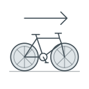
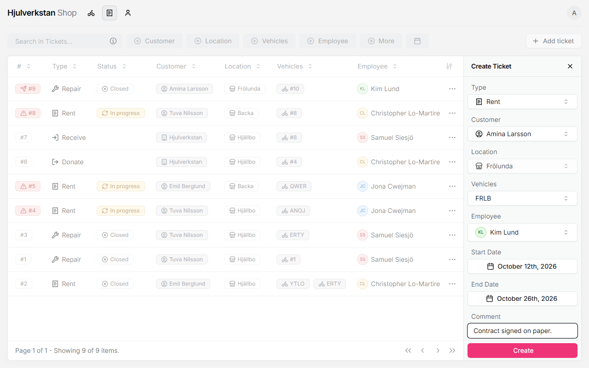

# Lending a bike

Lending a loan bike goes through a ticket, like a repair. The portal calls it *Rent*, though the bike is lent for free. The ticket says who has the bike and until when, keeps the bike off the website while it is lent, and warns you if it is not back in time. Only an *Available* loan bike at your workshop can be lent.

*Seen: tried on a test copy of the portal with made-up data, 2026-10-12.*

## 1. Before the computer

A new borrower signs the workshop's paper agreement once, saying what borrowing means, including their responsibility if something is lost. The portal does not hold the agreement. Every borrower needs a phone number; for a child, a parent's. Whose name goes in the portal when a child borrows, the child's or the parent's, is not decided yet.

*Seen: in the [Frölunda workshop](../transcripts/2026-09-16-frolunda.md#35-lending-bikes-and-tools--pt2-2239), §3.5. A digital agreement by text message is discussed there, but not decided. The child's name is open.*

## 2. Find or add the borrower

Find the borrower under **Customers**, or add them, as in [a bike comes in for repair](repair.md#2-find-or-add-the-customer). Only a person can borrow, not an organisation.

*Seen: tried on the test copy.*

## 3. Make the lending ticket

Open **Inventory**, press ⋯ on the loan bike, and choose **Create ticket**. The portal switches to **Tickets** with the bike and your workshop filled in.

In **Type**, click *Rent* once. Clicking it again empties the field. Then fill in:

- **Customer**: the borrower.

- **Employee**: the person lending out the bike.

- **Start Date**: the day the bike is collected, today or later.

- **End Date**: when the bike should be back. A rough date is fine, but one is needed.

- **Comment**, if there is anything worth knowing, such as that the agreement is signed.

Press **Create**. The ticket starts as *Ready*, and the bike becomes *Unavailable* at once, so nobody else can borrow it and it leaves the website. Its status cannot be changed until the ticket is closed.

\
A lending ticket. Both dates are needed.

*Seen: tried on the test copy, and in the portal's code.*

## 4. When the bike is collected

When the borrower takes the bike, press ⋯ on the ticket, then **Status**, and choose **In progress**.

If the start date has come and the ticket is still *Ready*, the ticket gets a red mark: "Bike ready, waiting for pickup". If the borrower never comes, close the ticket as in [a loan bike coming back](return.md), and choose *Available* for the bike.

*Seen: tried on the test copy.*
