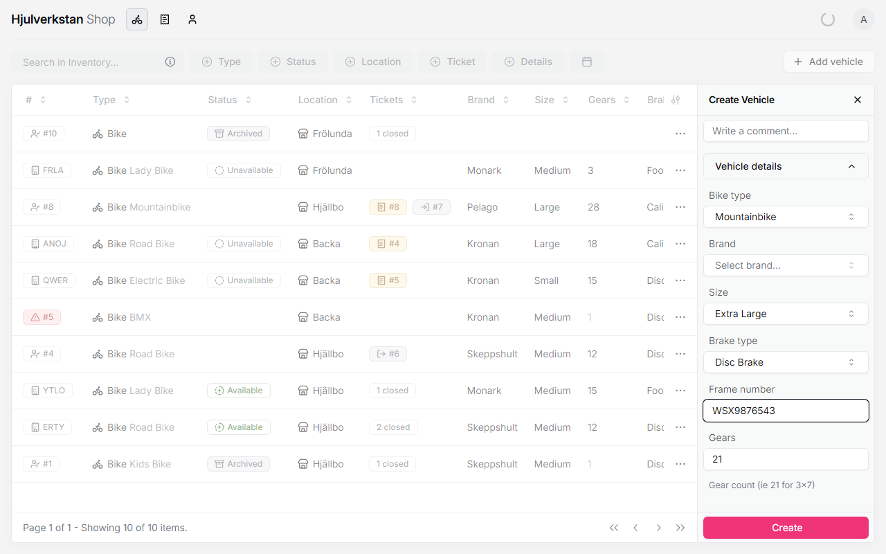
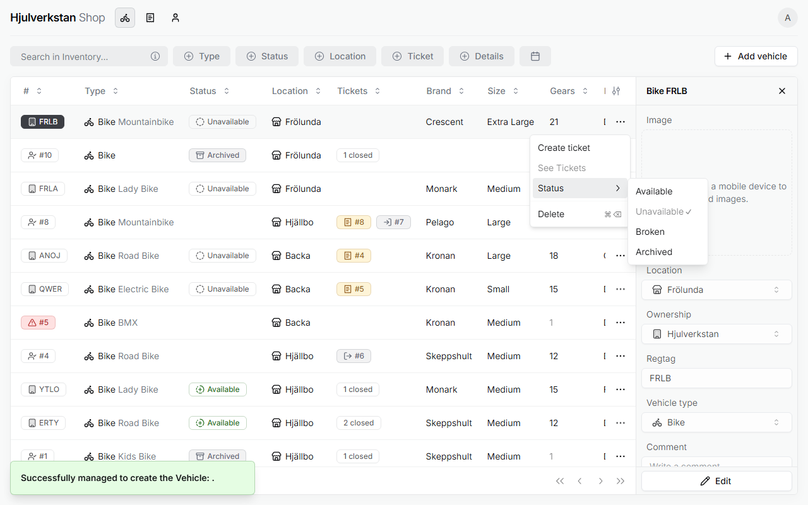
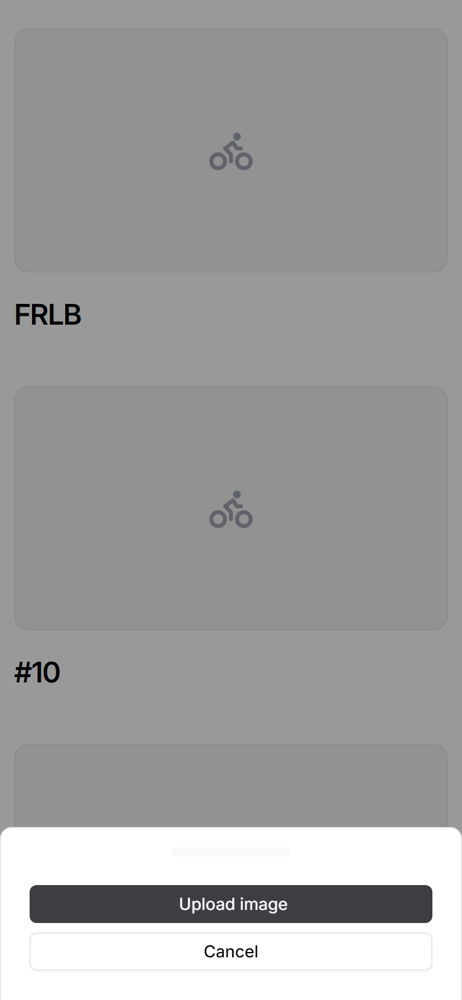
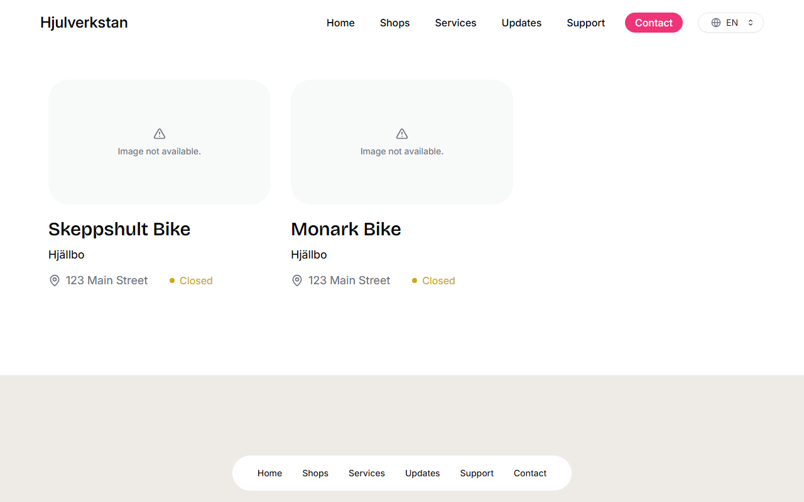

# Adding a loan bike

A loan bike is one of the workshop's own bikes, restored to lend out. It goes into the portal once, with its details filled in properly, because the portal shows it on Hjulverkstan's public website, where people can see which bikes their workshop has. A new loan bike can be lent only after you set it to *Available*.

*Seen: tried on a test copy of the portal with made-up data, 2026-10-12. The photo could not be uploaded from the test copy.*

## 1. Add the bike

Open **Inventory** and press **Add vehicle**. Fill in:

- **Location**: your workshop.

- **Ownership**: *Hjulverkstan*. This is what makes it a loan bike.

- **Regtag**: a short code of letters for the bike, such as `FRLB`. Write the same code on the bike, so the two can be matched.

- **Vehicle type**: *Bike*.

Then open **Vehicle details** and fill in **Bike type**, **Brand**, **Size**, **Brake type** and **Gears**. All of them are needed. **Frame number** can be added if you have it. Leave **Comment** empty, since a bike's comment is [not saved](no.md#i-things-that-go-wrong-without-a-message).

\
A loan bike's details. *Brand* is still empty here, which the portal will refuse.

Press **Create**. While something is missing, **Create** stays grey; hold the pointer over it to see what. If **Brand** is empty, though, **Create** still works, and then the portal says it [failed to create the vehicle](no.md#b-failed-to-create-the-vehicle). If the brand is not in the list, choose *Other*.

*Seen: tried on the test copy. That the workshop's bikes get a short letter code is from the [Frölunda workshop](../transcripts/2026-09-16-frolunda.md#42-tickets-and-their-statuses--pt2-4304), §4.2; writing it on the bike is a suggestion.*

## 2. Make it available

A new loan bike starts as *Unavailable*. When it is ready to lend, press ⋯ on its row, then **Status**, and choose **Available**.

\
A loan bike's statuses, as [the overview](README.md#3-bikes-people-and-tickets) explains them.

*Seen: tried on the test copy.*

## 3. Photograph it with a phone

Log in to the portal on a phone. Press the bike, then **Upload image**, and take or choose a photo.

\
Adding a photo on a phone.

*Seen: the phone view, on the test copy. The upload itself could not be tried there.*

## 4. On the website

The website shows a workshop's loan bikes on that workshop's page, each with its photo and brand. A bike is shown only while it is *Available*. So it leaves the website as soon as a [lending ticket](lending.md) is made for it, and comes back when it is set to *Available* again.

\
Loan bikes on a workshop's page on the website, from the test copy. Without a photo, the card says "Image not available." The yellow "Closed" is about the workshop's opening hours, not the bike.

*Seen: the page on the test copy, and the rule in the portal's code.*

## 5. After editing a loan bike, check its status

If you change a loan bike's details with **Edit**, set it to *Available* again afterwards, as in step 2. Saving [sets it back to *Unavailable*](no.md#i-things-that-go-wrong-without-a-message), and it disappears from the website.

*Seen: tried on the test copy.*
