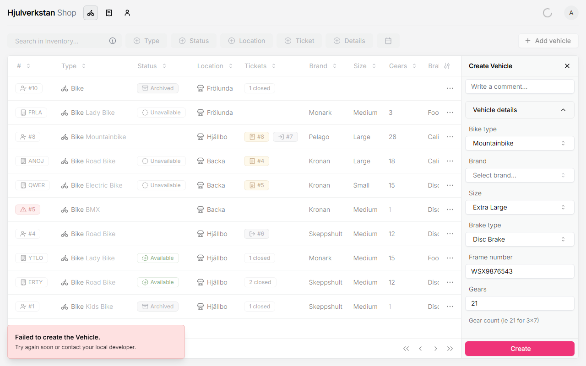
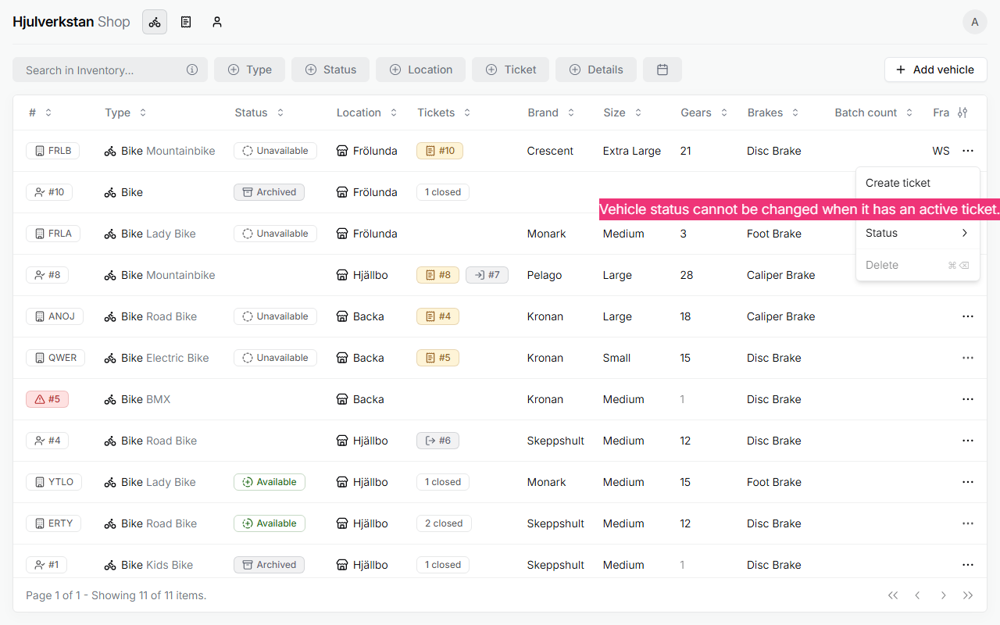

# Problems in the portal, and what to do

Sometimes the portal will not let you do something, or does something you did not expect. This page gathers those moments, each with what it means and what to do. Look up the one you meet; they can be read in any order.

*Seen: each one met on a test copy of the portal with made-up data, 2026-10-12, unless it says otherwise.*

## a. Create stays grey

**Create** stays grey while something needed is missing or filled in wrong. Hold the pointer over it to see why. Most messages name the field, such as "Reg Tag is required" or "Phone number must be in the format +46xxxxxxxxx". Two do not:

- "Invalid input: expected string, received undefined" means a required field is still empty: for a ticket, the customer, the employee, the repair description, or a lending ticket's dates.

- "Invalid input" under **Type** means the type was cleared, which happens when you choose the same type twice. Choose it again, once.

The portal shows one missing thing at a time, so check again after each fix.

*Seen.*

## b. "Failed to create the Vehicle"

"Failed to create the Vehicle. Try again soon or contact your local developer." appears when a loan bike has no **Brand**. Choose one, or *Other*, and press **Create** again. See [adding a loan bike](loan-bike.md#1-add-the-bike).

\
The message a loan bike without a brand gets.

*Seen; the cause read in the portal's reply behind the screen, 2026-10-12.*

## c. A phone number is refused

Write it as `+46701234567`, as in [a bike comes in for repair](repair.md#2-find-or-add-the-customer). Only Swedish numbers are taken, and what to do for a foreign number is not decided.

*Seen; what to do is open.*

## d. A bike's status cannot be changed

"Vehicle status cannot be changed when it has an active ticket." The bike is out on loan, or its ticket is otherwise open. Close the ticket first, as in [a loan bike coming back](return.md).

\
A bike with an open ticket: its status and *Delete* are locked.

*Seen.*

## e. A bike cannot be deleted

"Delete ticket first." A bike with tickets cannot be deleted. Do not delete its tickets to get there, since they are the record of the work. To take a loan bike out of use, set it to *Archived* instead.

*Seen.*

## f. A bike or a person is missing from a ticket's list

The lists on a ticket show only what that kind of ticket allows:

- **Vehicles** shows only bikes at the workshop chosen under **Location**, and stays grey until a location is chosen.

- For *Rent*, only *Available* loan bikes, and only people, not organisations.

- For *Donate*, only the workshop's own bikes.

- For *Receive*, only organisations, and only customers' bikes.

*Seen.*

## g. The text message to a customer failed

"SMS notification failed. Failed to notify the customer via SMS – try to send it manually." Text the customer yourself. The ticket keeps a red mark that says so. See [working through the queue](queue.md#3-tell-the-customer-it-is-ready).

*Seen.*

## h. A photo cannot be added on the computer

"Open portal on a mobile device to upload images." Photos are added from a phone, as in [adding a loan bike](loan-bike.md#3-photograph-it-with-a-phone).

*Seen.*

## i. Things that go wrong without a message

The portal does not warn you about four faults. Until they are fixed, work around them:

- **A bike's comment is not saved.** Write notes on the ticket instead.

- **Editing a loan bike sets it to *Unavailable*,** and it disappears from the website. Set it to *Available* again afterwards.

- **Editing a ticket sets it back to *Ready*,** even a closed one. After you press **Save** on a ticket, set its status again.

- **Giving a bike away does not archive it,** though the portal says it will. Set it to *Archived* yourself.

*Seen, on the test copy and in the portal's code; all four are noted in [the log](../log/2026-10-12-portal-guide-begun.md) as faults to fix.*
