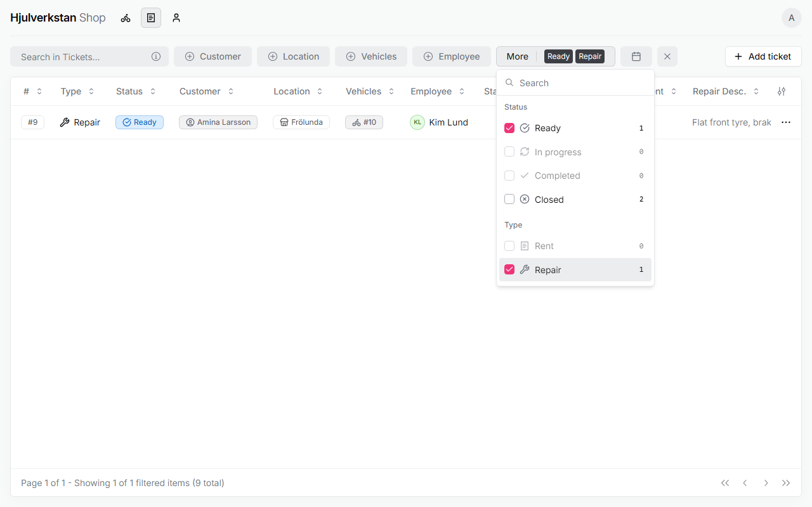
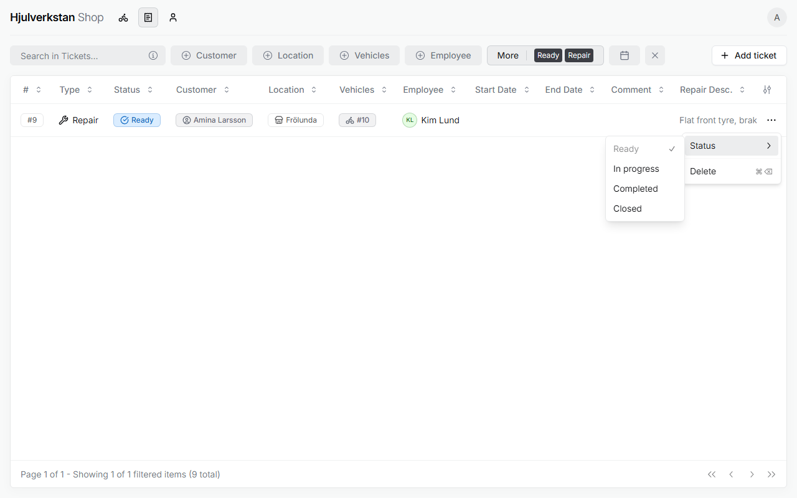
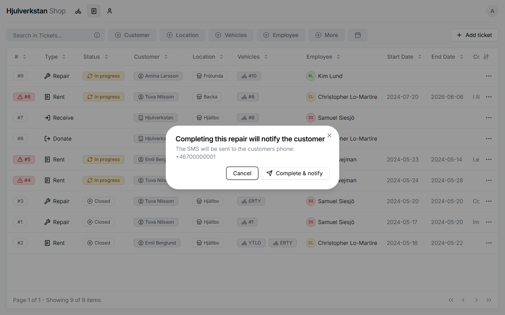
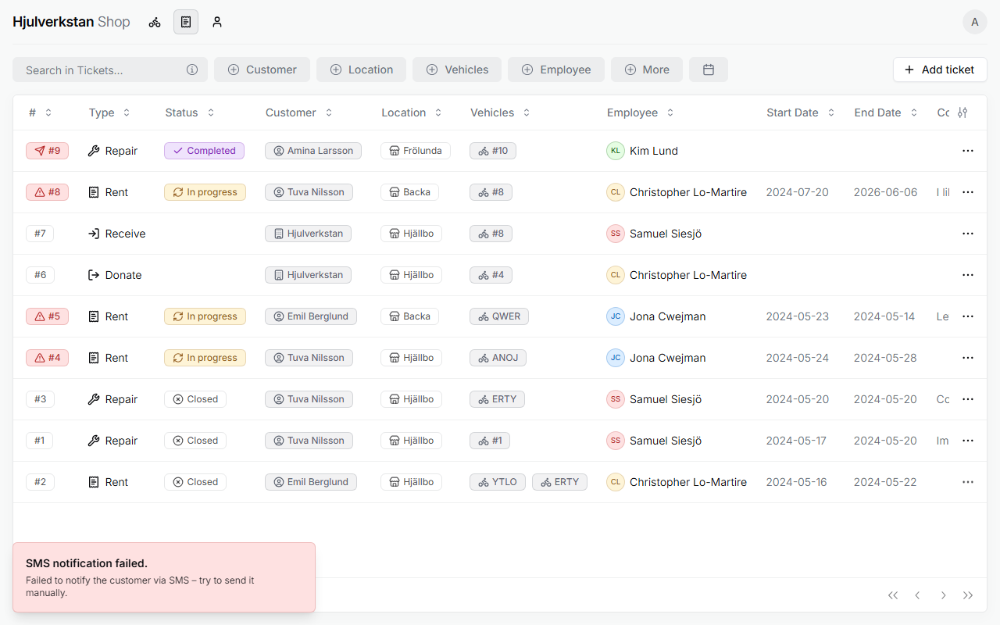

# Working through the queue

Once a repair ticket is made, the bike waits in line. This page takes it from waiting to collected: finding the next bike, starting the work, telling the customer it is ready, and handing it back. Each step is a change of the ticket's status, so everyone can see where every bike is.

*Seen: tried on a test copy of the portal with made-up data, 2026-10-12. The text message could not be sent from the test copy.*

## 1. Find the next bike

Open **Tickets**. Press **More**, and choose *Ready* under **Status** and *Repair* under **Type**. The list now shows only the repairs that are waiting.

\
The waiting repairs.

Tickets are listed by the day they were made, the newest at the top, so the bike that has waited longest is at the bottom. Read its **Repair Description** before you start: it says what is wrong and what was agreed with the customer.

The ✕ beside the filter buttons clears the filters when you want the whole list again.

*Seen: tried on the test copy; the order is also seen in the portal's code.*

## 2. Start the work

When you start on the bike, press ⋯ on its ticket, then **Status**, and choose **In progress**. Now everyone can see that the work has started.

\
A repair's statuses, in the ⋯ menu.

If you are not the employee named on the ticket, put yourself there, so everyone can see who has the bike. Press the ticket's number to open it, press **Edit**, choose yourself under **Employee**, and press **Save**. Saving sets the ticket back to *Ready*, so choose **In progress** again afterwards.

*Seen: tried on the test copy. That saving resets the status is a fault, noted on [when the portal says no](no.md#i-things-that-go-wrong-without-a-message). Whether the person who starts the work should always be the employee is a suggestion, not decided.*

## 3. Tell the customer it is ready

When the bike is done and put where customers collect their bikes, choose **Completed**. The portal then asks whether to send the customer a text message, and shows the phone number it will go to. Press **Complete & notify** to send it. **Cancel** leaves the ticket as it was.

The customer gets this message, with their own first name and your workshop:

> Hej Amina! Din cykel är redo att hämtas på Hjulverkstan i Frölunda

\
The portal asks before it texts the customer.

If the text cannot be sent, the portal says so: "SMS notification failed. Failed to notify the customer via SMS – try to send it manually." The ticket then gets a red mark with a paper plane, which says the same when you hold the pointer over it. Text the customer yourself.

\
When the text fails, the portal says so, and the ticket keeps a red mark.

The message does not say what was done to the bike. Say that when the customer comes, as the next step does.

*Seen: the dialog and the failure, on the test copy, where no text can be sent. The message's words are from the portal's settings. Putting the bike out front and texting at once is from the [Frölunda workshop](../transcripts/2026-09-16-frolunda.md#34-repair-the-work-and-the-handover--pt2-1537), §3.4.*

## 4. Hand the bike back

When the customer collects the bike, tell them what was done. It is best if the person who did the work says it, but the description on the ticket helps whoever is there. Then choose **Closed**. The customer's bike is then archived, as [the overview](README.md#2-bikes-people-and-tickets) says, and stays in **Inventory** marked *Archived*.

*Seen: closing and the archiving, on the test copy. The handover is from the [Frölunda workshop](../transcripts/2026-09-16-frolunda.md#34-repair-the-work-and-the-handover--pt2-1537), §3.4.*

## 5. A bike that has waited long

The portal does not yet remind you of a repair that has waited too long. Look at the waiting repairs now and then, starting from the bottom of the list. The workshop has asked for such a reminder.

*Seen: no such reminder on the test copy. The wish is from the [Frölunda workshop](../transcripts/2026-09-16-frolunda.md#44-what-the-workshop-wants-next--pt2-5723), §4.4.*
