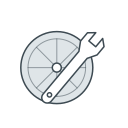
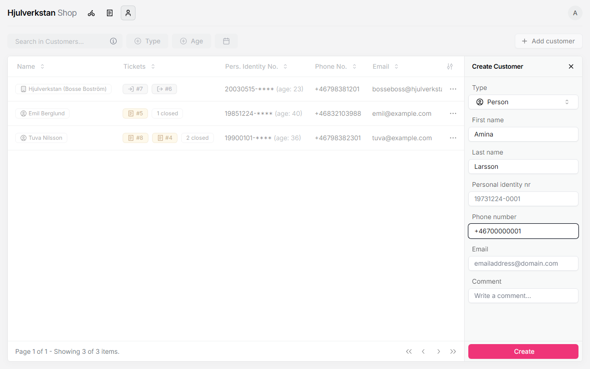
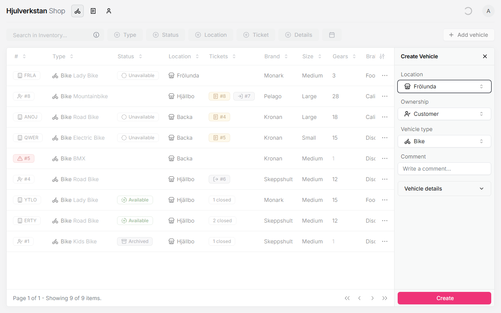
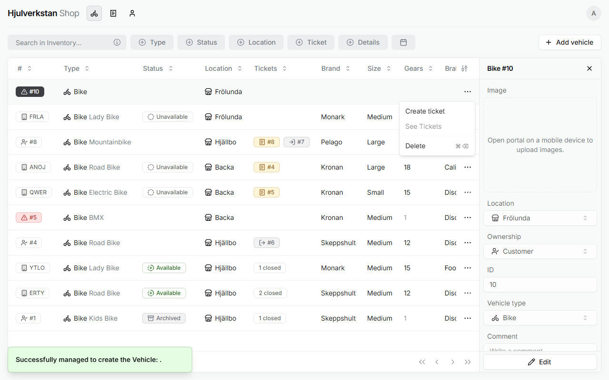
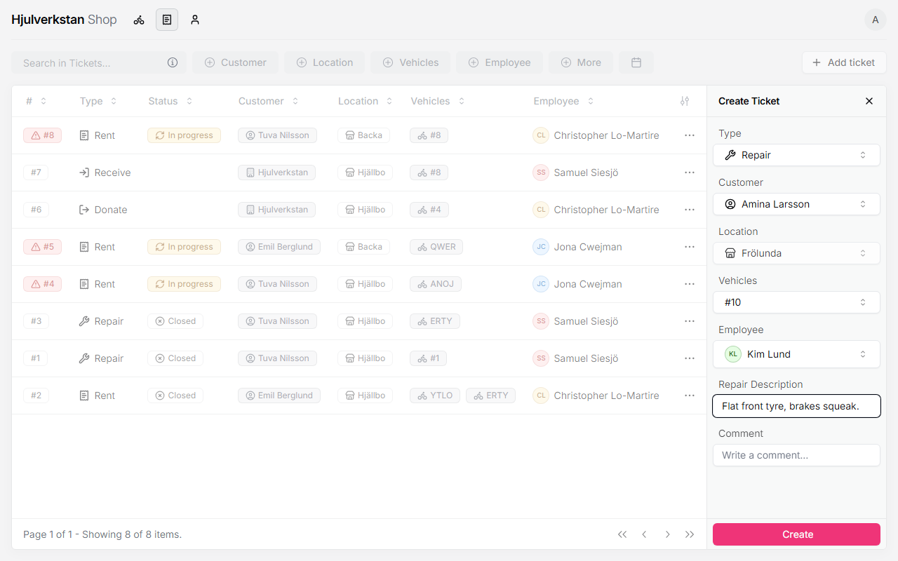

# A bike comes in for repair

When someone brings a bike to be fixed, you put it into the portal as a repair ticket. Then the bike is in the queue, anyone in the workshop can take on the job, and when it is done the portal can send the customer a text message. At the computer it takes three steps: the customer, their bike, and the ticket that joins them.

*Seen: tried on a test copy of the portal with made-up data, 2026-10-12; not yet tried in a workshop.*

## 1. Talk with the customer first

Look at the bike together: what works, what should be changed, and whether it is worth it. Say how long it usually takes, often two or three weeks, but do not promise a day. Then ask for the customer's name and phone number. The phone number matters most, because it is how the workshop tells them the bike is ready.

*Seen: how the workshop takes a bike in, in the [Frölunda workshop](../transcripts/2026-09-16-frolunda.md#33-repair-taking-a-bike-in--pt2-3352), §3.3.*

## 2. Find or add the customer

Open **Customers**, the person icon at the top left, and search for the customer. You can search by name, or by phone number without the 0 at the start: `701234567` finds them, `0701234567` does not. If they are already there, use them. Do not add them again.

If they are not there, press **Add customer**. Only two things are needed:

- **First name**.

- **Phone number**, written with Sweden's code, +46, instead of the 0 at the start: `+46701234567`, not `0701234567`. The portal accepts only Swedish numbers written this way. What to do for a customer with a foreign number is not decided.

Last name, personal identity number and email can be left empty. **Type** stays *Person*. Press **Create**.

\
Adding a customer, with made-up data. Name and phone number are enough.

*Seen: tried on the test copy. Searching first, so that nobody is added twice, is from the [Frölunda workshop](../transcripts/2026-09-16-frolunda.md#43-the-wizard--pt2-5203), §4.3.*

## 3. Add the customer's bike

Open **Inventory**, the bike icon, and press **Add vehicle**. Choose your workshop under **Location**. **Ownership** is already *Customer*, and **Vehicle type** already *Bike*, which is right for a customer's bike. Brand, size and the other details can be left out. Leave **Comment** empty too, since a bike's comment is [not saved](no.md#i-things-that-go-wrong-without-a-message); notes about the repair go on the ticket, in the next step. Press **Create**.

Add the bike this way even if the customer has brought it before. The portal does not link a customer to their bikes, so the old entry is hard to find.

\
Adding a customer's bike. Only the workshop has to be chosen.

After **Create**, the new bike's details open in the panel on the right, and it gets a number, such as #10. If the bike has a paper note on it, write this number on the note, so the right bike is found later. How bikes are marked is not decided yet.

The new bike has a red mark beside its number, which says it has no ticket yet. The mark goes away when you make the ticket in the next step. The **Image** box is for a photo, which can only be added from a phone; a customer's bike does not need one.

*Seen: tried on the test copy. Writing the number on the note, and adding a returning customer's bike again, are suggestions, not decided: a new ticket can also use the old bike, but its list shows every customer's bike at the workshop.*

## 4. Make the repair ticket

Stay in **Inventory**. Press ⋯ at the end of the bike's row and choose **Create ticket**.

\
The ⋯ menu on the new bike. *Create ticket* starts its ticket.

The portal switches to **Tickets** and opens a new ticket. The bike and your workshop are already filled in, and **Type** is already *Repair*. Fill in the rest:

- **Customer**: the customer from step 2. Each one is shown with their phone number.

- **Employee**: the person in charge of the repair. It can be changed later, if someone else takes on the job.

- **Repair Description**: what is wrong and what you agreed with the customer, in plain words, for the person who takes on the job.

- **Comment**, if there is anything else worth knowing.

Press **Create**.

\
The repair ticket, made from the bike. Customer, employee and description are filled in by hand.

The ticket gets a number of its own, such as #9. It is not the same as the bike's number. The ticket now stands under **Tickets** with the status *Ready*: the bike is in the queue.

*Seen: tried on the test copy. Whether the young adults are listed as employees, so they can be chosen here, is not known.*

## 5. If Create stays grey

**Create** stays grey while something needed is missing or filled in wrong. Hold the pointer over it to see why. What the messages mean is gathered on [when the portal says no](no.md#a-create-stays-grey).

*Seen: tried on the test copy.*
