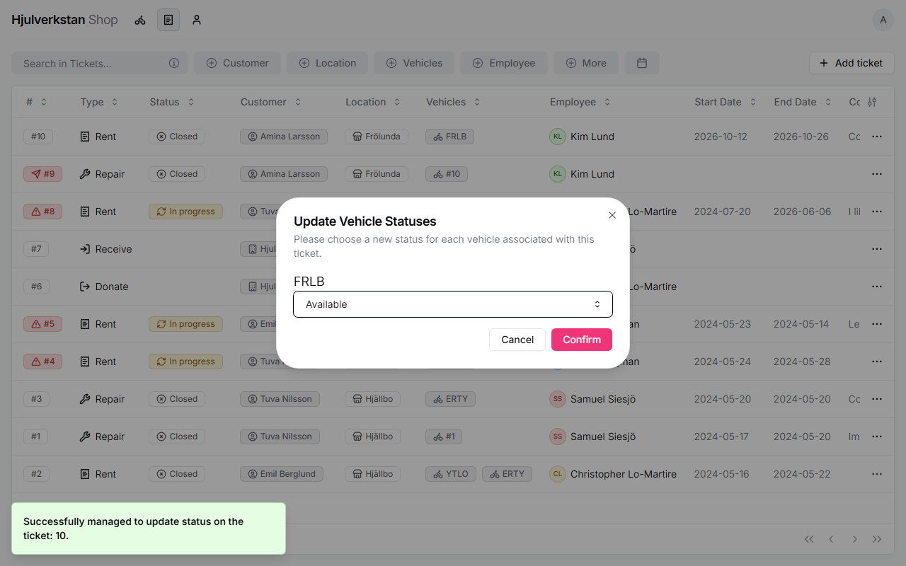

# A loan bike coming back

When a loan bike comes back, you close its lending ticket and say what state the bike is in. If you skip the second part, the bike stays *Unavailable*, and nobody can borrow it or see it on the website.

*Seen: tried on a test copy of the portal with made-up data, 2026-10-12.*

## 1. Close the ticket

Check the bike. Then open **Tickets**, press ⋯ on its lending ticket, then **Status**, and choose **Closed**.

The portal opens a window and asks for the bike's new status. Choose **Available** if it can be lent again, or **Broken** if it needs repair first. Press **Confirm**.

\
The bike's new status, asked for when the ticket is closed.

To record the repair of a *Broken* loan bike, the portal allows a repair ticket on it when the ticket's customer is an organisation, such as the workshop itself. Whether workshops do it this way is not decided yet.

*Seen: tried on the test copy. How a loan bike's repair is recorded is open.*

## 2. If you pressed Cancel

If the window was closed without a status, the ticket is closed but the bike is still *Unavailable*. Open **Inventory**, press ⋯ on the bike, then **Status**, and choose **Available** or **Broken**.

*Seen: tried on the test copy.*

## 3. A bike that is late

When the end date has passed and the ticket is still *In progress*, the ticket gets a red mark: "Bike still out past return date". What the workshop does then, such as calling the borrower, is not decided yet.

*Seen: the mark, on the test copy. What to do is open.*
