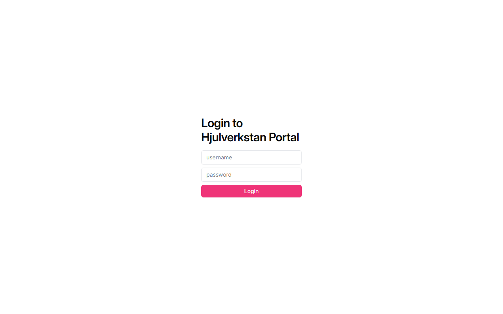
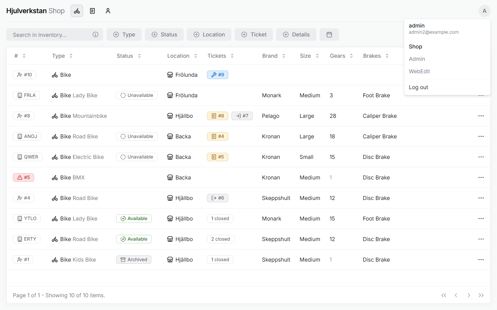
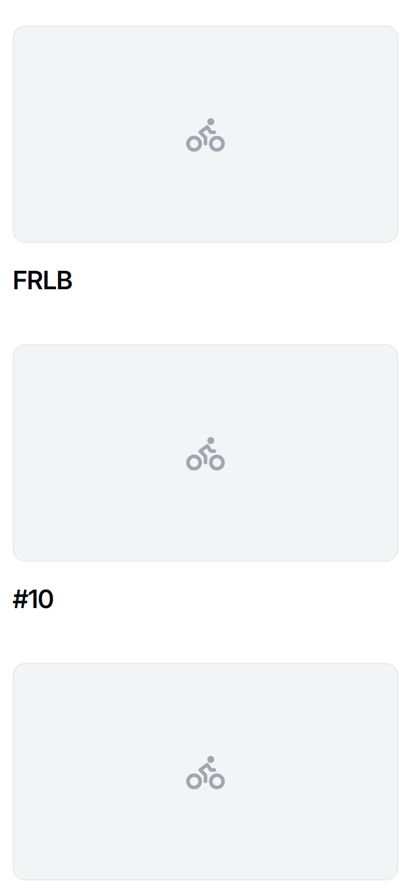

# Finding your way at the computer

Before the first task, it helps to know how the portal stays logged in, how every page of the portal works the same way, and what the phone is for. The portal is in English, and this guide uses its words.

*Seen: tried on a test copy of the portal with made-up data, 2026-10-12.*

## 1. Logging in and out

The workshop's computer stays logged in to the portal all the time, with a login of the workshop's own that opens only the everyday part, *Shop*. You do not need its password: the person responsible at your workshop keeps it, and logs in again when the portal has logged itself out, about every two weeks.

The portal's address is hjulverkstan.org/portal. Nothing on the website links to it, so keep it as a bookmark. If you want to try something without touching real bikes and customers, use the portal's test environment, at test.hjulverkstan.org/portal, which is there to play in. It has its own logins, so ask someone with Admin there for one.

\
The login page, which you see only when the portal has logged out.

The portal holds people's names and phone numbers, so lock the computer when you leave it. Do not log out, since the workshop's staff cannot log in again. Those who run the portal have logins of their own, and log out by pressing the round button with a letter at the top right, and choosing **Log out**.

\
The menu behind the round button. Most logins show only the username, its email and **Log out**; *Shop*, *Admin* and *WebEdit* are shown only to the people who run the portal.

*Seen: logging in and out, on a local copy of the portal. The workshop's login, who keeps it, and the test environment are carried from the [Web edit workshop](../transcripts/2026-10-21-web-edit-workshop.md#2-the-portal-three-environments-three-parts--0654), §2 and §4; the address is seen in the infrastructure's settings. That the computer should lock quickly is Jona's wish in the [Frölunda workshop](../transcripts/2026-09-16-frolunda.md#32-what-the-workshop-needs-from-a-system--pt2-0740), §3.2. The test address was found in public DNS, 2026-10-22, not opened; that it has its own logins is reasoned from each environment having its own database.*

## 2. Every page works the same way

**Inventory**, **Tickets** and **Customers** each show a list, one row per bike, job or person.

- **Search** in the box at the top left.

- **Filter** with the buttons beside it. A filter you have chosen shows on its button, and the ✕ next to the buttons clears them all. The portal remembers your filters until you clear them.

- **Add** with the button at the top right: *Add vehicle*, *Add ticket* or *Add customer*. A panel opens on the right, where you fill in the details and press **Create**.

- **Open** a row by pressing it. Its details open in the same panel, with an **Edit** button at the bottom.

- **Act** on a row with the ⋯ menu at its right end, for example to change a status or to make a ticket from a bike.

*Seen: tried on the test copy. That filters are remembered is seen in the portal's code and said in the [Frölunda workshop](../transcripts/2026-09-16-frolunda.md#41-where-it-stands--pt2-0502), §4.1.*

## 3. The phone is for photos

If you log in on a phone, the portal shows only a list of the bikes, each with room for a photo. It is used to photograph loan bikes, as [adding a loan bike](loan-bike.md) shows. Everything else is done on the computer.

\
The portal on a phone. Pressing a bike lets you add its photo.

Whose phone is used for this is not decided.

*Seen: tried on the test copy, in a phone-sized window.*
