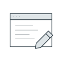
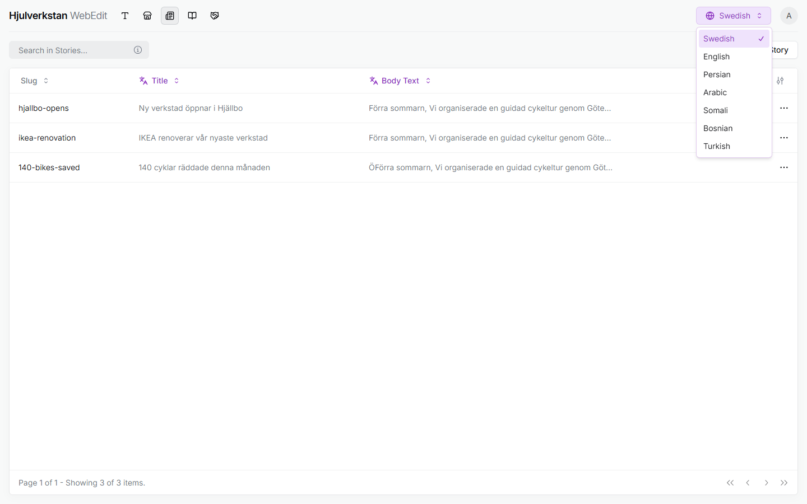
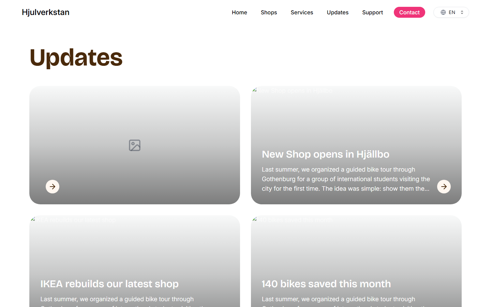
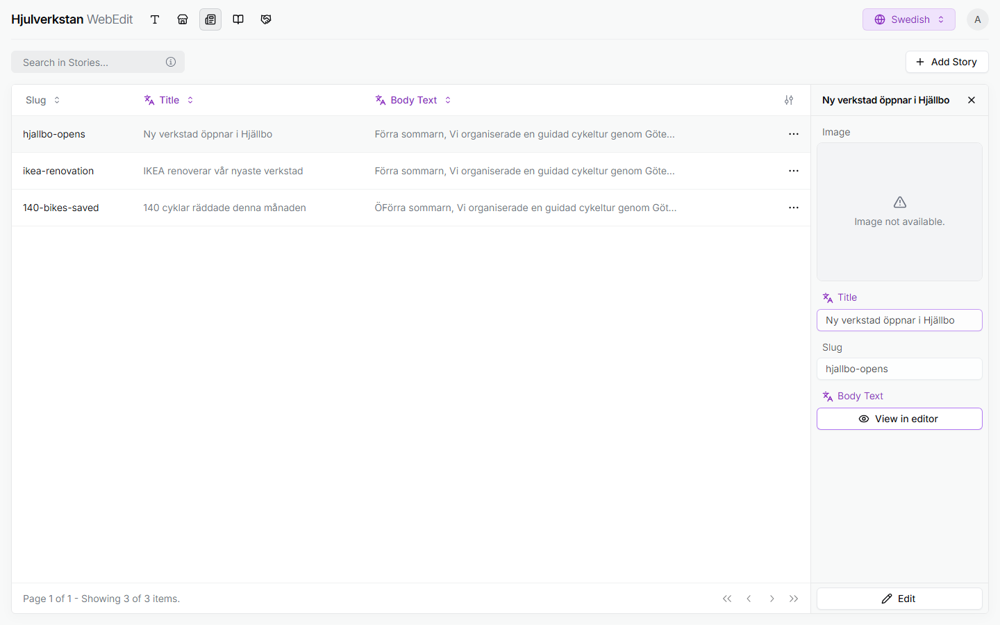
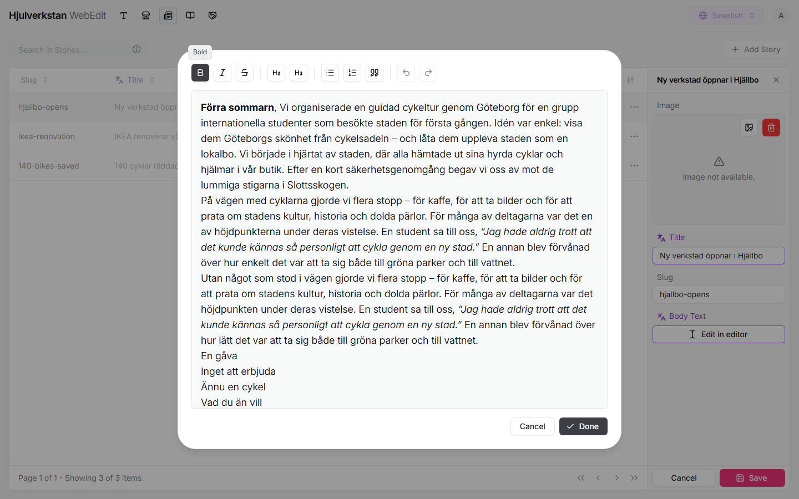
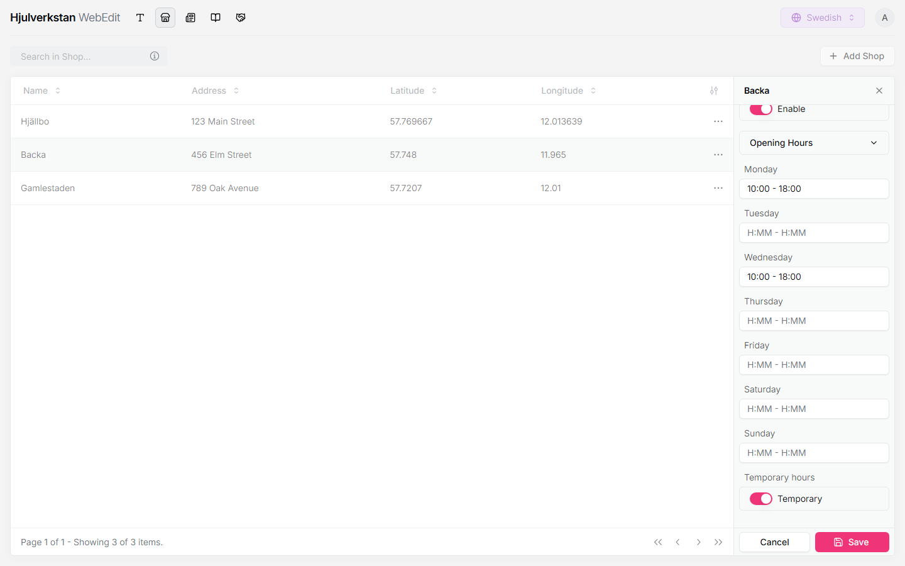
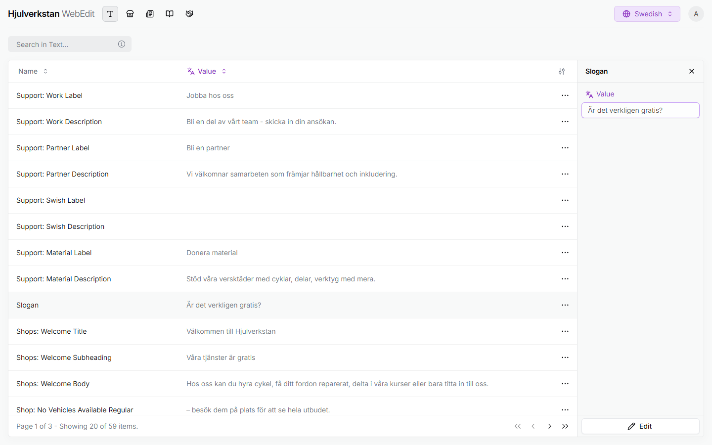

# Changing the website

Web edit is the part of the portal that holds what the public website shows: its news, called updates, the workshops' pages, and its texts, in several languages. This page is for whoever keeps the website at Save the Children. What you save goes out when Alten next publishes the website, and everything saved by then goes out with it.

*Seen: tried on a local copy of the portal with made-up data, 2026-10-22. How a change reaches the website is seen in the code and carried from the meeting, [as §3 says](#3-how-a-change-reaches-the-website). What Web edit is for, and who runs it, is carried from the [meeting on Web edit](../transcripts/2026-10-21-web-edit-workshop.md#5-web-edit--2536), §5.*

## 1. Getting in

Web edit needs an admin login of your own, which someone with Admin, the portal's part for logins and locations, makes for you. The login reaches Admin too, so you can set new passwords there for others who run the portal. Log in at hjulverkstan.org/portal, press the round button at the top right, and choose **WebEdit**.

Your first login comes with a simple password; change it first. Choose **Admin** from the same button, then the person icon, the last of the three at the top left. Press your own row and **Edit**, write the new password twice, and **Save**. There is no "forgot password": if you forget yours, someone with Admin sets a new one for you the same way.

To try things without touching the real website, use the portal's test environment, at test.hjulverkstan.org/portal. It has its own logins, so ask someone with Admin there for one. The test environment shows a change only once it has been published, for now by Alten, as on the real website.

*Seen: the **WebEdit** choice, in the run; that it needs an admin login, and Admin's person icon, in the code. Changing a password, the logins and the test environment are carried from the meeting, §2, §4 and §7, and not checked. The test address was found in public DNS, 2026-10-22, not opened; that it has its own logins is reasoned from each environment having its own database.*

## 2. How Web edit works

The tabs are the icons at the top left, in this order: **Text**, **Shops** and **Stories**, which hold what the website shows, **Stories** being its updates; then **Courses** and **Partners**, which have no page on the website yet, so leave them be. Each tab is a table: press a row to see it on the right, and press **Edit** there to change it.

The ⋯ menu at the end of a row holds **Delete**, which works differently in each tab, as the sections below say; in **Shops** it removes a workshop's whole page, whatever language is chosen and whatever the confirm box says. The language button at the top right switches which language you see and edit.

*Seen; the rest of the portal works the same way, as [finding your way](start.md#2-every-page-works-the-same-way) shows.*

## 3. How a change reaches the website

What you save in Web edit is kept in the portal, but the website does not read it there. The website is built from a copy of everything in Web edit, taken each time Alten publishes it again ([Alten's own page on it](../how-its-built/pipeline/republishing.md)), even when Alten publishes for another reason. So save only what is ready to be seen.

When something should go out, tell Alten. A way to publish yourself, with drafts and the earlier versions of every page, is sketched and hoped for in the spring.

*Seen in the code: the website is built from a copy of Web edit's data, and a **Publish** button is made but not yet shown. On the local copy, run for development without that copying step, the website read Web edit directly and changes showed at once; the test environment is built as the real website is. That Alten publishes, and the spring's plan, are carried from the meeting, [§5.1](../transcripts/2026-10-21-web-edit-workshop.md#51-what-web-edit-still-lacks--2915), and not checked; the plan is sketched, not in force. How to tell Alten is open until a place for feedback is arranged.*

## 4. Languages

Swedish comes first, and English follows: a new update can only be made with Swedish chosen, and should be given its English in the same sitting. Other languages are not ready on the website yet, and one translated row would put a half-blank website out in that language, so keep to these two until the website's own buttons and headings exist in that language, which Alten puts into the code.

\
The language button, with the seven languages Web edit holds.

Columns and fields marked in purple, with a small translate sign beside the name, are written separately in each language. The others, such as the image and the slug, the name in the page's address, are the same in all of them.

To translate, choose English, press the row, **Edit**, fill in the purple fields, and **Save**. A row not yet translated stands with empty cells, and an update with no English shows on the English website as an empty card, so do not leave one for a publish to find.

\
An update made in Swedish and not yet translated, as the English website shows it. The other cards lack their pictures only because images could not be loaded on the local copy.

The website offers a language as soon as anything is translated into it. One row of **Text** in Somali would put a Somali website out at the next publish, with every other text blank and names from the code, such as *availableBikes*, on its buttons and headings. A stray translation in **Text** is taken back with **Delete** in the ⋯ menu, with that language chosen; one in an update cannot be, so tell Alten.

*Seen: **Add Story** grey with English chosen; the empty English card; one Somali text putting Somali on the website with code names, and deleting it taking the language off. That an update's translation cannot be deleted outside Swedish is seen in the code. The meeting believed only Swedish and English were switched on, and that a missing translation falls back to Swedish, [§5.3](../transcripts/2026-10-21-web-edit-workshop.md#53-stories--3506); in the run, neither held. That Save the Children decides its languages and translates is carried from the meeting, §5, and not checked; keeping to Swedish and English for now is the session's advice, from the Somali finding.*

## 5. What you can change

The three tabs that hold what the website shows each need something different: an update is written, a workshop's page is filled in, and a text is reworded.

*Seen.*

### 5.a Writing an update

Updates are under **Stories**. They are the one place on the website to tell, in your own words, what happens in the workshops.

\
An update opened in **Stories**.

To write one, choose Swedish and press **Add Story**. Fill in the title and the slug, in lowercase words joined by hyphens. Press **Create in editor** to write the text, then **Done**, then **Create**. To change one, press **Edit**, then **Edit in editor**, then **Done** and **Save**. Either way, give it its English straight after, [as §4 says](#4-languages), before anything is published.

The editor has bold, italic, strikethrough, two sizes of heading, lists and quotes. The text cannot hold images or videos yet; an update has one image, at the top of the panel, which the website shows on its card. To add it, press **Edit** and drop a picture on the **Image** box, or press **browse** there.

\
The editor, opened from an update.

To remove an update, choose Swedish and **Delete** it from the ⋯ menu; it goes in every language.

*Seen, except the image: images could not be uploaded on the local copy, so adding one is read from the screen and where the website shows it from the code. Why updates matter is carried from the meeting, §5.3.*

### 5.b A workshop's page

Each workshop's page on the website is made under **Shops**, and is built on the workshop's location in the portal's Admin. The location gives the page its name and address, and lets it show the workshop's bikes, so a new workshop is added in Admin first, under its first icon, the locations. Then press **Add Shop**, and choose it under **Location**.

The page also holds an image, a slug, the latitude and longitude that place it on the map, its opening hours, and **Offer Vehicle Rentals**. Both numbers are needed: in Google Maps, right-click the workshop's door and copy the two numbers shown, the first being the latitude.

With **Offer Vehicle Rentals** set to **Enable**, the page lists the workshop's loan bikes that are *Available*. It is off at every workshop for now, and is switched on for one workshop at a time, once its bikes are photographed and in the portal; [adding a loan bike](loan-bike.md) shows how. Agree with Alten before switching it on.

Opening hours sit behind **Opening Hours**, which unfolds. Each day is written as `10:00 - 18:00`, and a day left empty is closed. **Save** stays grey until every day you fill in is written that way.

\
A workshop's opening hours, with **Temporary hours** switched on, in made-up data; the **Enable** at the top is rental, switched on there.

A new page starts with **Temporary hours** switched on, which the website does not show yet, [as below](#5b1-hours-that-change-for-a-while). Switch it off for ordinary hours. With it off, at least one day must be filled in, so a workshop closed every day is saved with it on.

*Seen; the new page's starting values, and that a page closed every day needs the switch on, are seen in the code. That the location lets the page show bikes, that rental is off for now and switched on one workshop at a time, are carried from the meeting, [§5.4](../transcripts/2026-10-21-web-edit-workshop.md#54-shops--3923), and not checked; agreeing with Alten first, and where to find the two numbers, are the session's advice.*

#### 5.b.1 Hours that change for a while

**Temporary hours** marks a workshop's hours as temporary, and is meant to show a small flag on the website. The website does not show it yet: it is saved, but nothing on the page reads it.

So for now, change the days to the hours that hold, and change them back when the ordinary hours return. For a message, such as the workshops' winter hours, a workshop's page has no place; an update can carry it meanwhile.

*Seen: the flag saved and missing from the website, and no code that shows it; the meeting believed it showed, §5.4. The meeting asked Save the Children for a winter message, §7; that an update can carry it is the session's suggestion. Open until Save the Children has said what changes to the hours there are beyond the winter, [§5.4.1](../transcripts/2026-10-21-web-edit-workshop.md#541-the-opening-hours-need-more--4058).*

### 5.c The website's texts

The website's other texts are under **Text**, each named by the page and place it stands in, such as *Shops: Welcome Title* or *Slogan*. You can change their wording, in Swedish and English as [§4](#4-languages) says, but not add a text. A new one comes with its place in the design, so to get one, give Alten the words.

\
A text opened in **Text**.

Not every word on the website is here. The buttons and some headings are kept in the code, such as *Tillgänliga cyklar* on a workshop's page, which is misspelt there; ask Alten to change those.

A few texts in **Text** still carry a name from the code, such as *enumTextShopDetailsAllVehicleBorrowedBold*; ask Alten to name them.

*Seen; the misspelt heading found in the code. The meeting thought it could be corrected in Web edit, [§6](../transcripts/2026-10-21-web-edit-workshop.md#6-faults-found--2640); it cannot. That the content is Save the Children's is carried from the meeting, [§5.5](../transcripts/2026-10-21-web-edit-workshop.md#55-text--5057), and not checked.*
