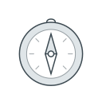

# What this wiki is for

This wiki is for Hjulverkstan first, and for Alten's interns beside it. For the workshops it is a standard way of working in the portal; for the interns it is where they learn, and a ground for whoever comes after them.

The interns built it as their practice, made from the start for Hjulverkstan to use and for them to be of service.

*The team's vision, 2026-10-22: §1 and §2 in force, §3 carried from Jona. Who keeps the wiki while no interns are working on it, and when each step is due, are open.*

## 1. For Hjulverkstan

For Save the Children, the most important part has been a standard way of working with the portal: one guide, so every workshop does each task the same way. What the work stands on, why Hjulverkstan exists and what it is for, is in [the initiative](initiative.md), and is not written again here.

The guide comes first: [the portal](portal/README.md), task by task, for the people in the workshops. It is written, and was walked on a local copy of the portal; the workshops start using the portal at the event on 24 October, as the [October client meeting](transcripts/2026-10-15-client-meeting.md#6-the-portal-is-ready--3307) planned.

Next, the guide is to ease the start for new staff, so someone new in a workshop learns the portal from it rather than only from a colleague. That stands on the guide being used, and is not begun as work of its own.

In the long term, Hjulverkstan uses it independently, without asking Alten. For example, Save the Children adds stories to the website themselves, both on the test copy and on the live website, and is secure doing it. The guide's page on [changing the website](portal/web-edit.md) is the first part of that. The rest waits on two things the portal's Web edit, where the website is changed, still lacks: a publish button, and drafts with history and rollback, both in [what's to come](to-come.md#21-web-edit).

*The team's, 2026-10-22: the guide written but not yet used in a workshop; the page on changing the website written; publishing independently waiting on the software. That a standard way matters most to Save the Children is the team's reading of the meetings.*

## 2. For Alten's interns

For the interns and developers who come next, the wiki holds the technical knowledge of the application in [how it's built](how-its-built/README.md), and what the project stands for in [the initiative](initiative.md).

It is also meant to give them ground to stand on when they start working with [the rule](the-rule/rule.md), the way of laying knowledge this wiki is written under, whether in this wiki or in something else entirely. The team's own experience of starting with it is in [the team's reflections](reflections.md).

A beginner's guide to working under the rule is wanted, and is to come as part of how the team builds a part of the wiki, which [how this wiki is made](making.md) still owes. Until then, fully onboarding an intern from the wiki is not expected: the rule is still being developed, and how a newcomer best takes it up is still being found.

*The team's, 2026-10-22: the technical and project knowledge written and growing, the beginner's guide owed. How anyone would know this part works is open.*

## 3. The wider vision

The wiki grew from a bigger vision, which is Jona Cwejman's, Alten's technical lead on Hjulverkstan. In it, the knowledge is one medium shared with the client: staff in the workshops comment where something is wrong and stamp what is right, and onboarding and offboarding stop being tasks of their own. It is told in [the Frölunda workshop](transcripts/2026-09-16-frolunda.md#15-the-ambition-one-medium-with-the-client--pt1-2857) and in [the October client meeting](transcripts/2026-10-15-client-meeting.md#5-what-it-can-be-for-save-the-children--2616).

What is learned here is also to come back into the rule, so that several projects, Hjulverkstan among them, build on each other's learning, as [the Frölunda workshop](transcripts/2026-09-16-frolunda.md#16-filling-it--pt1-4132) tells.

It is not the team's commitment, and much of it needs technology the wiki does not have; for now the wiki is read-only. The first small step named is a way for Save the Children to leave comments, which Alten is to propose.

*Carried from the two meetings, approved transcripts; the vision is Jona's and not the team's plan. The comments proposal: taken on by Alten in the October meeting, not yet made.*
